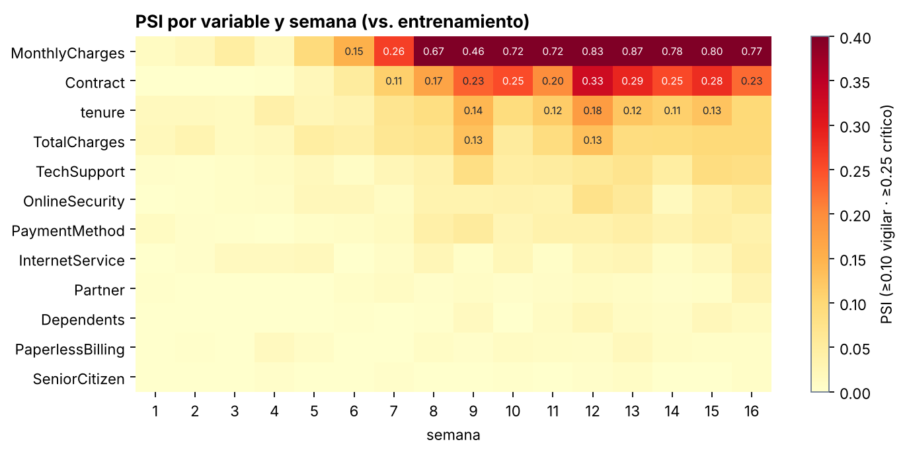
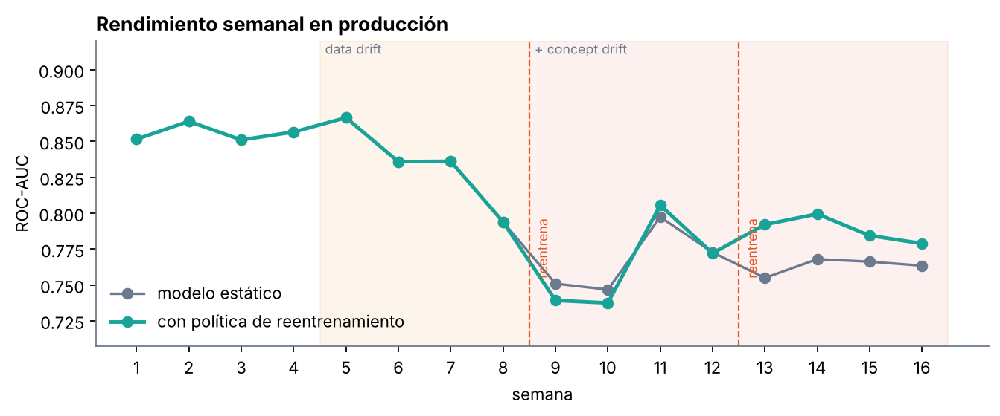
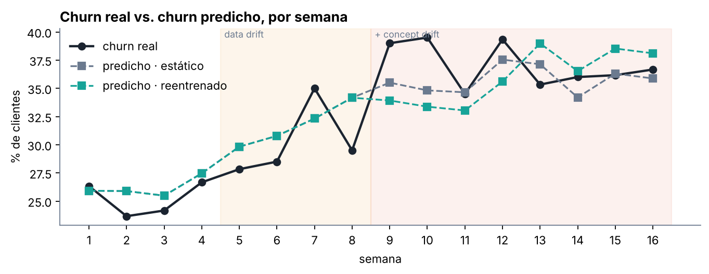

# Model Drift Monitoring

**Un modelo en producción se degrada en silencio. Este proyecto lo detecta, explica por qué pasa y decide cuándo reentrenar.**
Proyecto de portafolio · Científico de datos / MLOps · Python, scikit-learn, SciPy, Plotly

Inspirado en *“I Built an ML Pipeline That Retrains a Model When Performance Drops”* (13 sep) y *“How I Built an ML Model Monitoring Dashboard With Python”* (20 sep), de My Data Diary.

📊 **[Ver dashboard de monitoreo](https://jmanuelhe.github.io/dashboards/drift-monitoring.html)**

---

## El problema

El modelo de [churn-prediction-pipeline](https://github.com/jmanuelhe/churn-prediction-pipeline) tiene un ROC-AUC de 0,84 **el día que se entrena**. Pero los clientes cambian, la empresa sube tarifas y aparecen competidores. ¿Cómo sabemos que el modelo sigue sirviendo, y cuándo hay que reentrenarlo?

## Dos tipos de drift

| Tipo | Qué cambia | Ejemplo aquí | ¿Se ve sin etiquetas? |
|---|---|---|---|
| **Data drift** | La distribución de las entradas, P(X) | Más contratos mes a mes, tarifas +15 % | ✅ Sí, comparando distribuciones (PSI) |
| **Concept drift** | La relación entre entradas y salida, P(y\|X) | Un competidor “se roba” clientes con contrato largo y fibra | ❌ No, hace falta saber quién se fue de verdad |

## Simulación (16 semanas)

El dataset no trae fechas, así que el drift **se simula de forma controlada y reproducible** (`src/monitor/simulate.py`, semilla fija). Eso tiene una ventaja: como sabemos exactamente qué se inyectó, podemos verificar que el monitor lo detecta.

- **Semanas 1–4:** estable. Lotes de 600 clientes de la misma distribución del entrenamiento.
- **Semanas 5–16:** **data drift** gradual. Campaña que atrae contratos mes a mes (peso ×3) y alza de tarifas en rampa hasta +15 %.
- **Semanas 9–16:** además, **concept drift**. Clientes con fibra y contrato de 1–2 años, que el modelo considera “seguros”, ahora se van con probabilidad 50 %.

## Qué se monitorea

1. **PSI (Population Stability Index)** por variable, contra el entrenamiento. Umbrales estándar de la industria: < 0,10 estable · 0,10–0,25 vigilar · > 0,25 crítico.
2. **KS y chi-cuadrado** como complemento. Con muestras grandes casi todo sale “significativo”, por eso la alerta se basa en el **tamaño del efecto (PSI)**, no en el p-valor.
3. **PSI de las predicciones:** ¿cambió la distribución de los scores?
4. **ROC-AUC semanal**, cuando llegan las etiquetas reales. Se usa ROC-AUC y no PR-AUC porque **PR-AUC sube cuando sube la tasa de churn**, aunque el modelo empeore.
5. **Calibración:** churn real vs. churn predicho promedio.

## Política de reentrenamiento (`src/monitor/policy.py`)

Se reentrena si **(A)** el ROC-AUC cae más de 10 % frente a la línea base, **o (B)** una variable clave (tenure, Contract, InternetService, MonthlyCharges) está en PSI crítico **2 semanas seguidas**. Hay **3 semanas de enfriamiento** después de cada reentrenamiento, y se entrena con las últimas 4 semanas etiquetadas.

## Resultados



- **El monitor detectó exactamente lo que se inyectó:** `MonthlyCharges` pasa a vigilancia en la semana 6 y a crítico en la 7 (PSI hasta 0,87). Le sigue `Contract` (hasta 0,33). Las variables que no se tocaron se mantienen por debajo de 0,10.
- **El concept drift no aparece en el PSI** (ninguna fila “se enciende” en la semana 9). Solo se ve en el rendimiento. Por eso monitorear solo los datos no es suficiente.



| Periodo | Modelo estático | Con política |
|---|---|---|
| Semanas 1–4 | 0,856 | 0,856 |
| Semanas 9–10 | 0,749 | 0,738 |
| Semanas 13–16 | 0,763 | **0,789** |

### Lo que enseña (incluido lo que no funcionó)

1. **El primer reentrenamiento (semana 8) no ayudó; empeoró un poco.** Se disparó por data drift y entrenó con datos de las semanas 5–8, **antes** del concept drift. Reentrenar con datos que no contienen el cambio no sirve de nada.
2. **El segundo reentrenamiento (semana 12) sí recuperó rendimiento** (+0,026 de AUC), porque ya incluía 4 semanas con el nuevo comportamiento.
3. **No se recupera el 0,85 original:** parte del concept drift es aleatorio (el 50 % de un grupo se va), y eso es ruido que ningún modelo puede predecir. Reentrenar no es magia.
4. El disparador por **PSI reacciona antes**, pero a veces por el motivo equivocado. El disparador por **rendimiento** es más confiable, pero exige etiquetas, que en churn real llegan con semanas o meses de retraso. Una política madura combina los dos.



## Uso

```bash
pip install -r requirements.txt
python -m src.monitor.run   # simula, monitorea, genera gráficos y reports/dashboard.html
python -m pytest -q         # PSI, niveles, política y simulación
```

## Próximos pasos

- Ventana de reentrenamiento **adaptativa** (más datos recientes cuando el AUC cae más).
- Pruebas *champion/challenger*: el modelo nuevo solo reemplaza al viejo si gana en un *holdout* reciente.
- Llevar el monitor a un job programado (GitHub Actions / Airflow) con alertas por Slack o correo.
